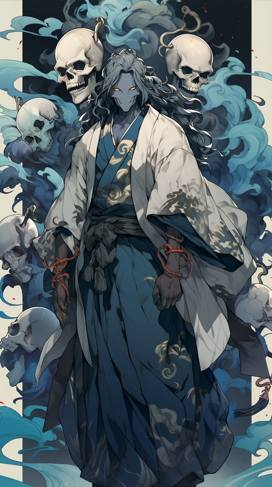
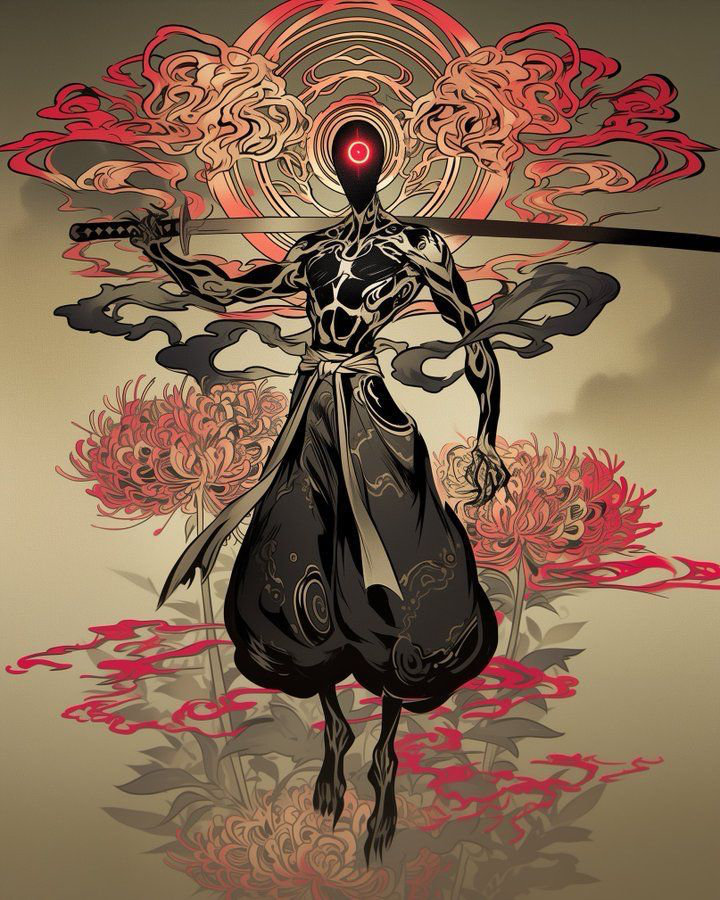
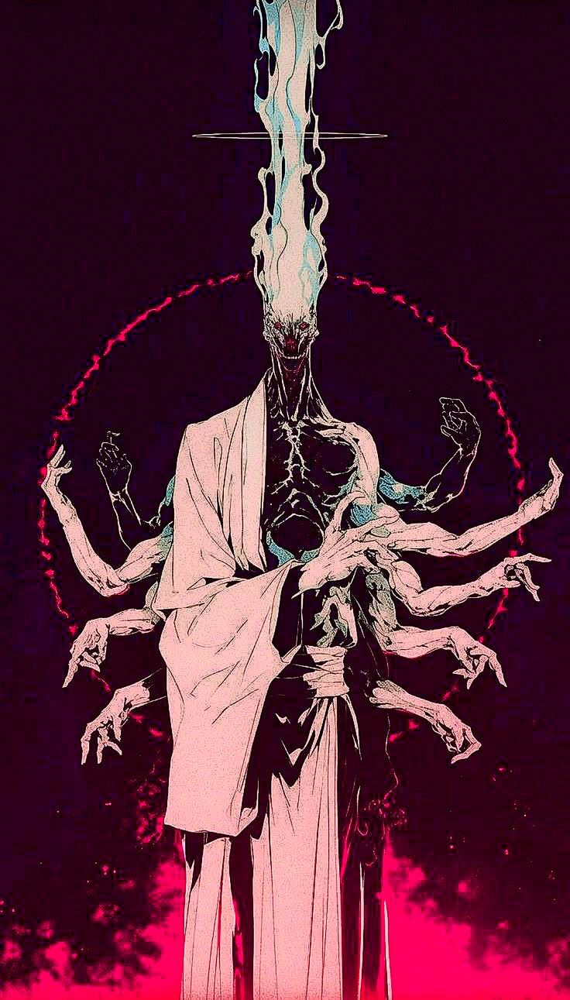
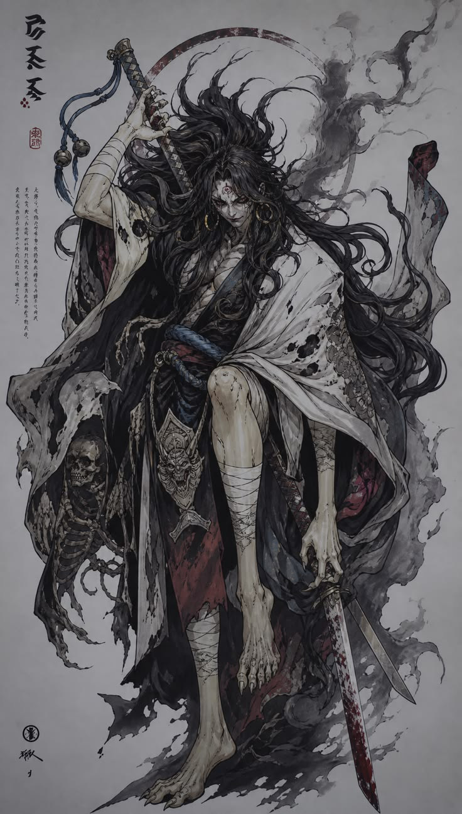
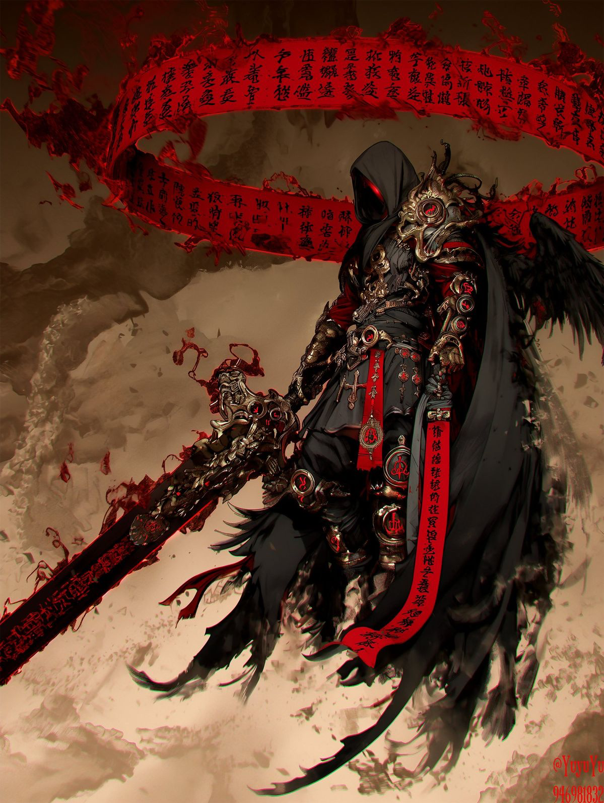

# Акты

Игра делится на акты (сейчас запланировано 6, можно добавлять). Каждый акт — одна локация со своей палитрой, врагами и боссом. Внутри акта 3 зоны по 10 этапов (30 этапов на акт). В конце каждой зоны мини-босс, в конце акта главный босс с фазами. Перед актом короткая сюжетная сценка. После 6-го акта начинается следующий «круг» с теми же актами и множителем силы врагов.

Референсы героев и боссов лежат в [docs/refs](refs).

## Акт I. Поле Адасино

**Локация.** Окрестности Киото: бамбуковая роща Сага переходит в Адасино, старое поле, куда веками относили умерших. Тысячи каменных статуй дзидзо, покосившиеся фонари, синие блуждающие огни ониби, бирюзовый туман над землёй. Палитра босса: индиго, бирюза, кость, красные шнуры.

| Зона | Этапы | Враги | Мини-босс |
|---|---|---|---|
| Бамбуковая роща Сага | 1–10 | каппа, тануки | Тануки Бумбуку |
| Заброшенная деревня | 11–20 | призрачные огни, скелеты-асигару | Фонарь-обакэ |
| Поле Адасино | 21–30 | черепа гасядокуро, ониби | — |

**Босс: Курояма Сэйгэн, онмёдзи-отступник.** Жрец клана Курояма, который сломал печать и приоткрыл врата Ёми. Связывает сюжет: с него всё началось.
- Фаза 1: призывает 3 летающих черепа. Пока черепа живы, у него щит −50% урона.
- Фаза 2 (50% HP): бирюзовый дым лечит его, пока на поле есть черепа. Черепов нужно бить в первую очередь.

## Акт II. Долина хиганбаны

**Локация.** Осень на дороге Кисо. Рисовые террасы и берега реки сплошь в красных паучьих лилиях хиганбана, цветах мёртвых, на фоне огромного закатного солнца. В конце разрушенное додзё. Палитра: бежевый, красный, чёрная тушь.

| Зона | Этапы | Враги | Мини-босс |
|---|---|---|---|
| Рисовые террасы | 31–40 | тэнгу, вороны-карасу | Ворон-тэнгу |
| Берег хиганбаны | 41–50 | безликие ученики, каппа | Речной дух |
| Разрушенное додзё | 51–60 | тени мечников | — |

**Босс: Безликий мастер меча.** Душа сэнсэя додзё, у которого Ёми забрала лицо. Остался один красный глаз.
- Дуэль: каждый 5-й удар героя он парирует и отвечает.
- Фаза 2: рывок иайдзюцу через весь экран с предупреждением красным кругом, удар по герою ×3.

## Акт III. Сожжённый храм на горе Хиэй

**Локация.** Горный монастырь воинов-монахов, сожжённый за одну ночь. Тысяча ступеней через криптомерии, обугленные залы, ночь цвета сливы и красная луна. Палитра: тёмно-фиолетовый, малиновый, бирюзовое пламя.

| Зона | Этапы | Враги | Мини-босс |
|---|---|---|---|
| Тысяча ступеней | 61–70 | сохэй-призраки, они | Страж ворот Нио |
| Сожжённые залы | 71–80 | горящие монахи, фонари | Колокол-цукумогами |
| Главный зал | 81–90 | руки из пола | — |

**Босс: Тысячерукий Кайсэн.** Настоятель, сросшийся со статуей тысячерукой Каннон. Из головы бьёт бирюзовое пламя.
- Фаза 1: руки атакуют волнами. Руки — отдельные цели, каждая сбитая рука снимает часть его брони.
- Фаза 2: столб пламени с подготовкой 2 секунды. Без щита или лечения герой теряет 60% здоровья.

## Акт IV. Поле Сэкигахары

**Локация.** Поле великой битвы под вечным туманом. Весь акт нарисован как тушевый свиток: серый, чёрный, только кровь и знамёна красные. Сломанные копья, брошенные флаги-сашимоно, вороны. Палитра: бумага, тушь, кровь.

| Зона | Этапы | Враги | Мини-босс |
|---|---|---|---|
| Брошенный лагерь | 91–100 | асигару-мертвецы, вороны | Знаменосец |
| Поле в тумане | 101–110 | конные призраки, лучники | Генерал без головы |
| Холм знамён | 111–120 | они в доспехах | — |

**Босс: Сюра, демон-ронин.** Ронин, павший в битве и вернувшийся из мира асуров. Третий глаз, бинты, окровавленный меч, маска они на поясе.
- Чем меньше у него здоровья, тем быстрее и сильнее он бьёт.
- Фаза 2 (30% HP): надевает маску они, удары накладывают кровотечение.

## Акт V. Адские источники Ундзэн

**Локация.** Вулкан Ундзэн на Кюсю: кипящие серные источники, которые японцы и называли «адами» (дзигоку), охристый пар и пепел, рядом крепость Симабара после подавленного восстания. Отсюда кресты и чужеземные знаки на броне босса. Палитра: сепия, охра, чёрное золото, кровавый красный.

| Зона | Этапы | Враги | Мини-босс |
|---|---|---|---|
| Серные поля | 121–130 | огненные колёса ванюдо, они | Сютэн-додзи |
| Руины Симабары | 131–140 | мертвецы-повстанцы, вороны | Комендант крепости |
| Дзигоку | 141–150 | демоны-палачи | — |

**Босс: Жнец Ундзэна.** Палач, который служит судье мёртвых Эмме и ведёт его свиток приговоров. Безликий капюшон, крылья, огромный меч с красными письменами.
- Фаза 1: вокруг него летит красный свиток. Раз в 15 секунд он «вписывает имя» героя: за 5 секунд нужно нанести заданный урон, иначе удар на 70% здоровья.
- Фаза 2 (50% HP): взлетает на крыльях. Удары ближнего боя по нему слабее вдвое, лук, сюрикены и навыки бьют полностью.

## Акт VI и дальше
- **Акт VI. Гора Осорэ, врата Ёми.** Финал первой истории, Идзанами. Серые вулканические поля и озеро Усори у настоящей горы Осорэ подходят как вход в страну мёртвых. Ждёт референса босса.
- Структура не ограничена шестью актами: новый акт добавляется записью в данных, без изменения кода.

## Как реализовать
1. **Данные.** Файл `src/data/acts.ts`: акт, его зоны, палитра, слои фона, набор врагов, мини-боссы, главный босс и сюжетная сценка. Сейчас в `src/data.ts` плоский список из 6 глав по 10 этапов, он заменяется актами по 30 этапов.
2. **Номер этапа.** Глобальный номер этапа остаётся в сохранении. Акт, зона и этап внутри зоны считаются из него, на экране пишется «Акт I · 2-7».
3. **Фоны.** У каждой зоны 3 слоя параллакса (дальний, средний, ближний) и свои частицы: синие огни, лепестки хиганбаны, пепел, туман. Пока рисуются кодом, потом заменяются на нарисованные слои без изменения логики.
4. **Боссы.** Общий класс босса со сценарием фаз: список правил «при HP ниже X% сделать Y». Готовые действия: призвать помощников, щит пока помощники живы, лечение, рывок с предупреждением, ускорение, кровотечение. Каждый босс собирается из них в данных, без отдельного кода на каждого.
5. **Сценки.** Перед актом 2–3 кадра: иллюстрация и пара строк текста, пропуск по тапу.
6. **Тушевый стиль акта IV.** Фильтр на весь кадр (обесцвечивание, кроме красного) плюс отдельная палитра.
7. **Круги.** После акта VI номер круга растёт, враги становятся сильнее, лут выше уровнем.
